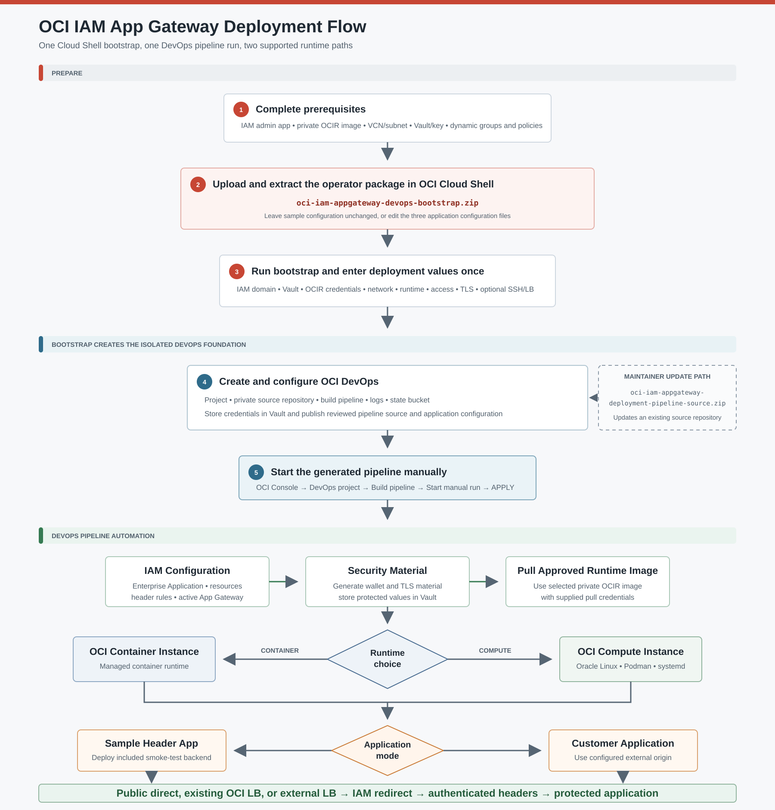
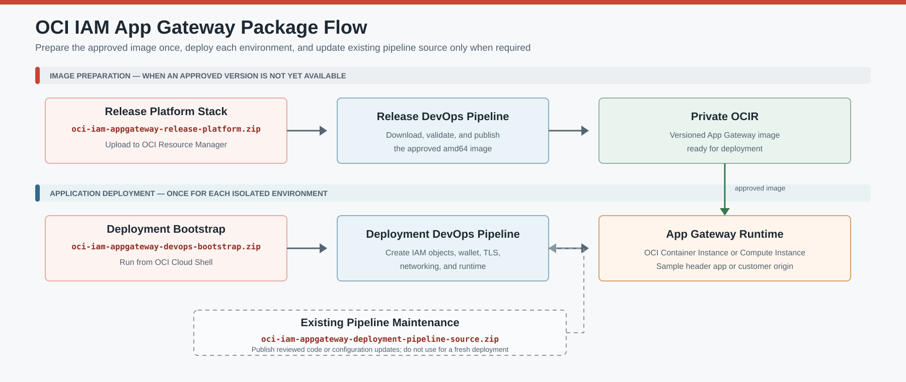

# OCI IAM App Gateway Deployment Automation

## Introduction

OCI IAM App Gateway enables applications that use header-based authentication
to delegate user authentication to an OCI IAM Identity Domain. This project
provides a repeatable deployment workflow for App Gateway and the IAM objects,
security material, runtime infrastructure, and application policies required to
protect an enterprise or custom application.

The deployment is driven through OCI Cloud Shell and OCI DevOps. An operator
provides the target-domain, network, Vault, image, and application details once.
The generated DevOps pipeline then creates the domain-specific configuration
and deploys App Gateway on the selected OCI runtime.



## Solution Overview

The solution separates the approved App Gateway software image from each
application deployment:

- A generic, approved App Gateway image is stored in private OCIR.
- Customer credentials and application configuration are collected during
  deployment and are not embedded in the image.
- The pipeline creates the Enterprise Application, resources, header mappings,
  App Gateway, wallet, and TLS material for the target IAM Identity Domain.
- The same workflow supports OCI Container Instances and OCI Compute Instances.
- A sample header application is available for smoke testing. Customer mode
  deploys App Gateway only and connects it to the supplied origin application.

## Key Capabilities

- Guided Cloud Shell bootstrap
- Isolated OCI DevOps project and pipeline per deployment name
- Private source repository for reviewed configuration
- Secrets and generated security material stored in OCI Vault
- Private OCIR image pull
- Sample and customer application modes
- CSV-based protected-resource rules
- JSON-based identity-header mappings
- Public direct, existing OCI Load Balancer, or external load-balancer access
- Generated self-signed or customer-provided App Gateway TLS certificates
- Optional Compute SSH access restricted to a trusted CIDR
- Apply, update, and destroy operations through the DevOps pipeline

## Runtime Choices

| Runtime | Recommended use | Operational model |
|---|---|---|
| OCI Container Instance | Teams that want a managed container runtime | Review runtime and container logs in the OCI Console |
| OCI Compute Instance | Teams that require host access or detailed operating-system troubleshooting | Oracle Linux 8, Podman, systemd, and optional SSH |

Both runtimes use the same IAM application configuration and approved App
Gateway image. Runtime selection changes the hosting model, not the protected
application policy.

## Deployment Modes

### Header Authentication Sample

Leave the supplied application configuration files unchanged. The pipeline
deploys App Gateway and a lightweight backend that displays the authenticated
headers received from App Gateway.

### Customer Application

Update the application properties, protected resources, and header mappings.
The pipeline deploys App Gateway without the sample backend. The supplied origin
application must already be reachable from the selected subnet.

The prerequisites guide includes a PeopleSoft ERP example with two managed
resources and four username headers. A placeholder origin can validate pipeline
completion and IAM configuration, but it does not validate application access.

## Security Model

- IAM administrator and OCIR credentials are stored as Vault secrets.
- The App Gateway wallet is generated for the target Identity Domain during deployment.
- The wallet and TLS private key are not committed to the source repository.
- DevOps and runtime permissions use dynamic groups and compartment-scoped policies.
- Existing deployments remain pinned to the selected OCIR image tag until intentionally updated.
- Direct ingress and optional SSH can be limited to trusted CIDRs.

## Documentation

### Before application deployment

Confirm that an approved, versioned `amd64` App Gateway image already exists in
private OCIR.

- **Image exists:** continue with the deployment prerequisites below.
- **Image does not exist, or a new version is required:** a release
  administrator must complete the
  [App Gateway image publication runbook](release/docs/appgateway-image-publication-runbook.md).

The image-publication procedure is shared platform preparation. It is not
repeated for every application deployment.

### Application deployment

First complete the deployment prerequisites, then choose the runbook for the
selected runtime:

1. [Deployment prerequisites](deployment/docs/prerequisites.md)
2. Choose one:
   - [Container Instance deployment runbook](deployment/docs/container-deployment-runbook.md)
   - [Compute Instance deployment runbook](deployment/docs/compute-deployment-runbook.md)

Follow only the runbook for the selected runtime. Release administrators can
use the separate
[image publication runbook](release/docs/appgateway-image-publication-runbook.md).

## Deployment Packages



| Package | Purpose | When to use |
|---|---|---|
| `oci-iam-appgateway-release-platform.zip` | Resource Manager stack that creates the shared private OCIR repository, Vault secrets, and release DevOps pipeline | Use when preparing the first approved App Gateway image or publishing an approved upgrade |
| `oci-iam-appgateway-devops-bootstrap.zip` | Main operator package that creates an isolated deployment DevOps project and deploys App Gateway on a Container Instance or Compute Instance | Use for every new App Gateway environment |
| `oci-iam-appgateway-deployment-pipeline-source.zip` | Maintenance package that publishes reviewed pipeline code or application configuration to an existing DevOps source repository | Use only to update an existing deployment pipeline; it is not required for a fresh deployment |

For a normal deployment, start with
`oci-iam-appgateway-devops-bootstrap.zip`. The release-platform package is a
shared prerequisite only when the approved private OCIR image is unavailable.

## Project Structure

```text
release/      Builds and publishes approved App Gateway images
platform/     Creates shared image-release services
deployment/   Bootstraps and deploys customer App Gateway environments
```

The main customer deployment package is:

```text
deployment/dist/oci-iam-appgateway-devops-bootstrap.zip
```

## Expected Result

A successful deployment provides:

- Active Enterprise Application and App Gateway in the target IAM domain
- Generated App Gateway wallet and TLS material in the selected Vault
- Active Container Instance or Compute Instance runtime
- Protected landing URL that redirects unauthenticated users to OCI IAM
- Authenticated requests forwarded to the application with configured headers

Begin with the [deployment prerequisites](deployment/docs/prerequisites.md).
