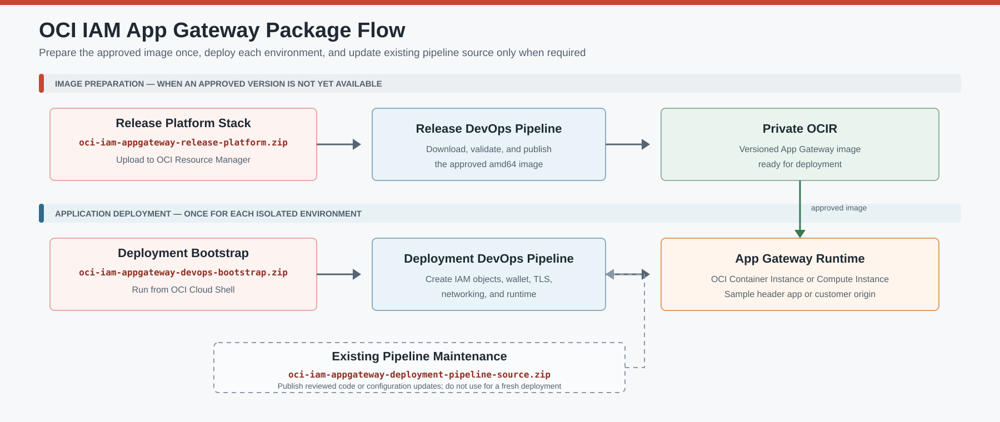

# OCI IAM App Gateway Deployment Guide

## Introduction

This package deploys OCI IAM App Gateway for applications that accept
header-based authentication. It automates the target IAM configuration,
App Gateway wallet, TLS material, OCI runtime, and optional sample application
through an OCI DevOps build pipeline.

The same package supports an OCI Container Instance or OCI Compute Instance.
Use the sample application for an initial end-to-end test, then provide
application-specific resources and header mappings for an enterprise or
homegrown application.



## Package Selection

| Package | Purpose | When to use |
|---|---|---|
| `oci-iam-appgateway-release-platform.zip` | Creates the shared release platform and publishes approved App Gateway images to private OCIR | Use only when an approved image is not already available |
| `oci-iam-appgateway-devops-bootstrap.zip` | Creates a new isolated deployment pipeline and deploys App Gateway | Use for every new environment; this is the normal starting package |
| `oci-iam-appgateway-deployment-pipeline-source.zip` | Updates source or application configuration in an existing deployment repository | Use for maintenance only, not for a fresh deployment |

## How the Deployment Works

1. The operator prepares the required OCI resources, dynamic groups, policies,
   credentials, and application configuration.
2. `bootstrap-devops.sh` collects the deployment values and creates an isolated
   OCI DevOps project, private source repository, build pipeline, logs, state
   storage, and protected Vault secrets.
3. The operator starts the generated build pipeline from the OCI Console.
4. The pipeline validates the application files and creates the Enterprise
   Application, protected resources, header mappings, App Gateway, wallet, and
   TLS material in the target IAM Identity Domain.
5. Terraform deploys App Gateway on the selected runtime and optionally adds the
   runtime to an existing OCI Load Balancer backend set.
6. The operator verifies the IAM redirect, application access, and forwarded
   identity headers.

## What the Deployment Creates

- OCI DevOps project, private source repository, build pipeline, logs, and notifications
- Private Object Storage bucket for deployment state
- Vault secrets for deployment credentials, App Gateway wallet, and TLS material
- IAM Enterprise Application, protected resources, header mappings, and App Gateway
- Selected OCI Container Instance or OCI Compute Instance runtime
- Included sample backend when the supplied sample configuration is unchanged
- Existing OCI Load Balancer backend registration when selected

## Supported Choices

### Runtime

| Runtime | Use when |
|---|---|
| Container Instance | A managed container runtime and OCI Console-based operations are preferred |
| Compute Instance | SSH access, host-level logs, or operating-system control is required |

### Application

| Mode | Behavior |
|---|---|
| Header Authentication Sample | Deploys App Gateway and the included sample backend |
| Customer application | Deploys App Gateway only and proxies to the configured origin |

### Access

| Mode | Behavior |
|---|---|
| Public direct | Assigns a public IP when the subnet permits it |
| Existing OCI Load Balancer | Adds the runtime private IP to the selected backend set |
| External Load Balancer | Leaves load-balancer, DNS, listener, and health-check configuration to the customer |

## Before You Start

Complete the [deployment prerequisites](docs/prerequisites.md). Prepare the
dynamic groups and policies before starting the generated build pipeline.

Choose the appropriate runtime runbook:

- [Container Instance deployment](docs/container-deployment-runbook.md)
- [Compute Instance deployment](docs/compute-deployment-runbook.md)

## Quick Start

1. Upload `oci-iam-appgateway-devops-bootstrap.zip` to OCI Cloud Shell.
2. Extract it into a new directory:

   ```bash
   work_dir="$HOME/appgateway-deployment-$(date +%Y%m%d%H%M%S)"
   mkdir -p "$work_dir"
   unzip -oq "$HOME/oci-iam-appgateway-devops-bootstrap.zip" -d "$work_dir"
   cd "$work_dir/oci-iam-appgateway-devops-bootstrap"
   ```

3. Choose the application mode:
   - Leave `pipeline-source/config/` unchanged for the included sample.
   - Update the three files described in
     [Application configuration](docs/prerequisites.md#application-configuration)
     for a customer application.
4. Run bootstrap:

   ```bash
   chmod +x bootstrap-devops.sh
   ./bootstrap-devops.sh \
     --region 'us-ashburn-1' \
     --compartment-ocid '<deployment-compartment-ocid>'
   ```

5. Enter the values collected in the prerequisites checklist.
6. When prompted by Git, enter the OCI DevOps Git username and an OCI auth token.
7. Open the generated OCI DevOps project and build pipeline.
8. Choose **Start manual run**, confirm `OPERATION=APPLY`, and start the run.
9. Follow the verification section in the selected runtime runbook.

## Application Configuration

The following files define the protected application:

```text
pipeline-source/config/application.properties
pipeline-source/config/app_resources.csv
pipeline-source/config/header_mappings.json
```

The pipeline compares them with the supplied defaults:

- Unchanged files select sample mode and deploy the sample backend.
- Application-specific values select customer mode and do not deploy the sample backend.

The customer origin application must be reachable from the selected runtime
subnet. The landing hostname, protected resources, and identity headers must
match the application's expected configuration.

For a configuration-only test, the pipeline can deploy successfully with a
syntactically valid but unavailable origin. In that case, IAM redirection and
App Gateway startup can be checked, but application access will fail after
authentication. See the [PeopleSoft ERP example](docs/prerequisites.md#peoplesoft-erp-example)
for a complete three-file custom configuration.

## Updating an Existing Environment

Edit a reviewed copy of the three configuration files and publish it to the
existing DevOps repository:

```bash
./bootstrap-devops.sh \
  --repository-url '<application-source-repository-url>' \
  --config-dir '/path/to/config'
```

Start the existing build pipeline after publication. This updates the source
and configuration without creating another DevOps project.

## Deployment Operations

- `OPERATION=APPLY` creates or updates the selected environment.
- `OPERATION=DESTROY` removes the runtime and IAM objects recorded for that deployment.
- Use a unique 3-31 character lowercase deployment name for each independently managed environment.
- A failed run can leave IAM objects that were created before the failure. Use
  a new deployment and application name for an isolated retry, or remove the
  failed objects after confirming they are not used.
- Bootstrap state is retained in Cloud Shell at
  `~/.oci-iam-appgateway-devops/<deployment-name>/foundation.tfstate`.
- A new approved image tag affects only new deployments or an intentional update.

### Cleanup boundaries

| `DESTROY` removes | Remains after `DESTROY` |
|---|---|
| Compute Instance or Container Instance runtime and runtime network resources | DevOps project, source repository, pipeline, logs, and notification topic |
| Existing OCI Load Balancer backend registration created for the deployment | Terraform state bucket and Cloud Shell foundation state |
| Enterprise Application, App Gateway, server, and mapping recorded in deployment metadata | Bootstrap credential secrets and generated wallet/TLS secrets in Vault |
| Runtime Terraform state and deployment metadata objects | Selected Vault, encryption key, and approved OCIR image |

Review retained secrets and foundation resources after a successful destroy and
remove them through the normal OCI retention and change-management process when
the environment is no longer required. A failed deployment might require
manual IAM cleanup when automatic rollback could not complete.

## TLS and Load Balancers

Generated TLS mode creates a self-signed App Gateway certificate for the landing
hostname. Customer TLS mode reads an existing PEM certificate and private key
from Vault secrets.

An OCI or external load balancer may present a different enterprise certificate
to users. When it connects to App Gateway over HTTPS, configure backend trust
for the App Gateway certificate or issuing CA.

## Application References

- [PeopleSoft and OCI IAM](https://docs.oracle.com/en/learn/oci-iam-auth-peoplesoft/index.html#introduction)
- [JD Edwards SSO with OCI IAM](https://www.oracle.com/webfolder/technetwork/tutorials/jdedwards/White%20Papers/JDESSO-Using-OCI-MS-Entra-ID.pdf)
- [OAS App Gateway and OCI IAM](https://docs.oracle.com/en/learn/appgw-oas-iamdomain/index.html#task-3-deploy-the-app-gateway-docker-image)
